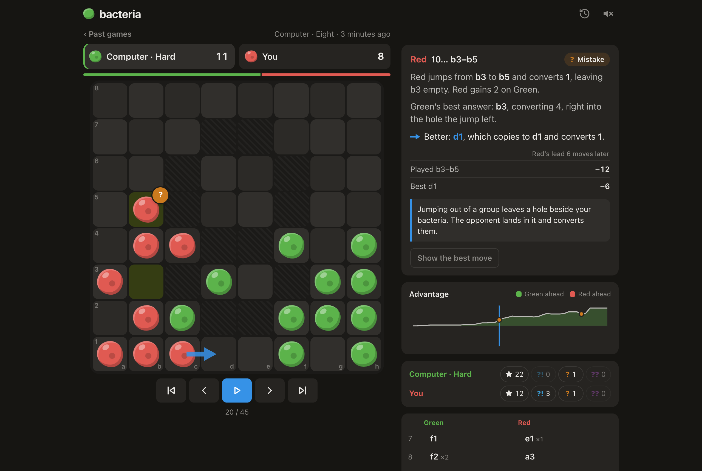

# Bacteria

A two-player bacteria game in the browser. One Rust binary serves the page and runs the games.

- **Play with a friend**: create a game, share the link, it starts when they open it (like Lichess).
- **Play the computer**: easy, medium or hard.
- **Pass and play**: two players on the same screen.
- **Past games**: every finished game is saved. Replay it move by move and see what each move was worth, what the best move was, and why.

## Learning from a game

Open **Past games** (clock icon, top right), or **Review moves** at the end of a game.



- Step through with `←` `→` (`Home`/`End`, `Space` to autoplay), or tap a move in the list.
- Moves are written like chess: files `a`–`h` from the left, ranks `1`–`8` from the bottom.
  A copy is just its target (`d4`, any neighbour gives the same board); a jump is `b2–b4`. `×3` means it converted 3.
- Each move is graded against the best one, looking 6 moves ahead (3 each) and counting the lead (your cells minus theirs):
  ★ best, ✓ good, ?! inaccuracy (3–5 cells worse), ? mistake (6–10), ?? blunder (more, or a won game let slip).
- On the board, a badge on the move just played shows its grade, and a blue arrow shows the better move.
- The panel says what the move did, the opponent's best answer, the better move and a tip.
  **Show the best move** plays the better move and the answer to it on the board.
- The chart shows who was ahead after each move. Tap it to jump there. The counts under it jump to your next mistake.
- **My games** lists the games played in this browser. There are no accounts: every game is public, at `/r/<id>`.

## Rules

The rules and the six 8x8 boards come from [noxio](https://github.com/thalkz/noxio).

- Tap one of your bacteria, then an empty cell:
  - any neighbouring cell, diagonals included: the bacterium **copies** itself;
  - exactly two cells away in a straight line (no diagonals): it **jumps** (over anything) and its old cell empties.
- Where it lands, it **converts** every enemy bacterium around it, diagonals included.
- **30 seconds per move**. Run out and you lose. If one of the first two moves isn't played in time, the game is aborted.
- When the player to move has no legal move, the game ends and every empty cell goes to the other player. The player with the most cells wins.

## Run it

```sh
docker compose up -d --build     # http://localhost:3000
```

Without Docker (needs Rust): `cargo run`. Tests: `cargo test`.
To run the tests through Docker:

```sh
docker run --rm -v "$PWD":/app -w /app rust:1 cargo test
```

`PORT` sets the listening port (default `3000`). `DATA_DIR` is where finished games are saved (default `./data`, `/data` in Docker,
kept in the `games` volume by `docker compose`).

## Deploy on a VPS

On the server:

```sh
git clone <repo> bacteria && cd bacteria
docker compose up -d --build
```

Put a reverse proxy in front for HTTPS. With Caddy, which also forwards WebSockets:

```
bacteria.example.com {
    reverse_proxy localhost:3000
}
```

With nginx, forward the WebSocket upgrade on `/ws/`:

```nginx
location / {
    proxy_pass http://127.0.0.1:3000;
    proxy_http_version 1.1;
    proxy_set_header Upgrade $http_upgrade;
    proxy_set_header Connection "upgrade";
    proxy_set_header Host $host;
}
```

To build on a Mac for an x86 VPS: `docker buildx build --platform linux/amd64 -t bacteria .`

## How it works

```
src/game.rs      rules: moves, conversions, end of game
src/ai.rs        computer opponent (greedy / 2-ply / timed alpha-beta)
src/analysis.rs  grades every move of a finished game (same alpha-beta, fixed depth 6)
src/history.rs   finished games: data/games.jsonl, one JSON line per game, loaded at startup
src/maps.rs      the six 8x8 boards from noxio
src/room.rs      rooms, seats, move clock, rematches (all in memory)
src/main.rs      HTTP + WebSocket server (axum), /api/history endpoints
static/          the page: vanilla JS, no build step, embedded in the binary
```

The server is authoritative. The browser animates your move right away and the server confirms it.
Games in progress live in memory: restarting the server ends them. Idle rooms are dropped after 30 minutes.
Finished games (not aborted ones) are appended to `games.jsonl` and stay replayable at `/r/<id>`, also after the room is gone.
An analysis takes about a second, runs at most two at a time, and is cached in memory.
Each player gets a token stored in `localStorage`, so reloading the page keeps your seat.
To test online play on one computer, open the invite link in a private window or another browser.
